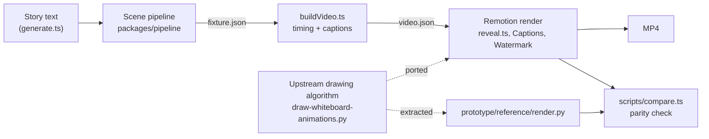
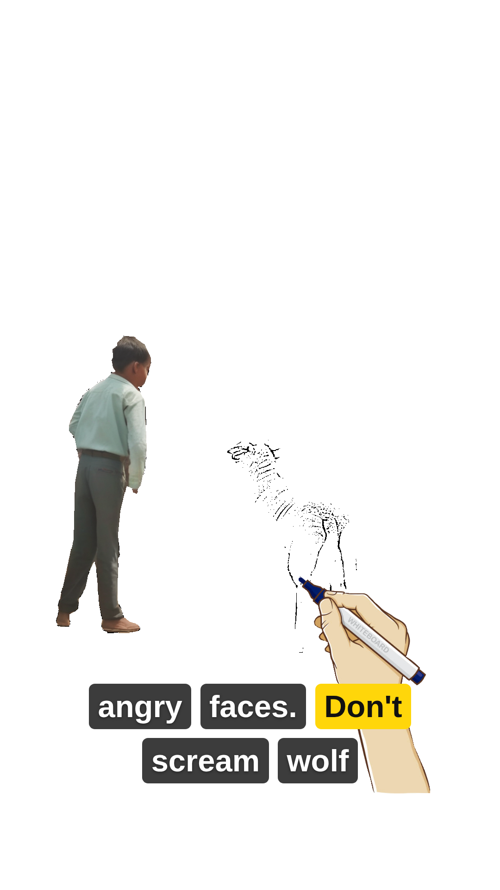
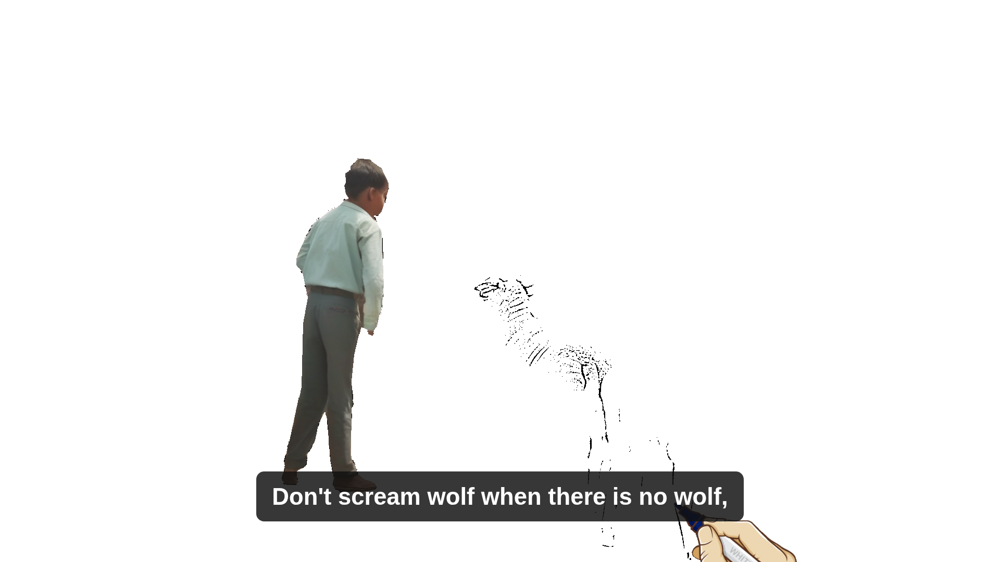
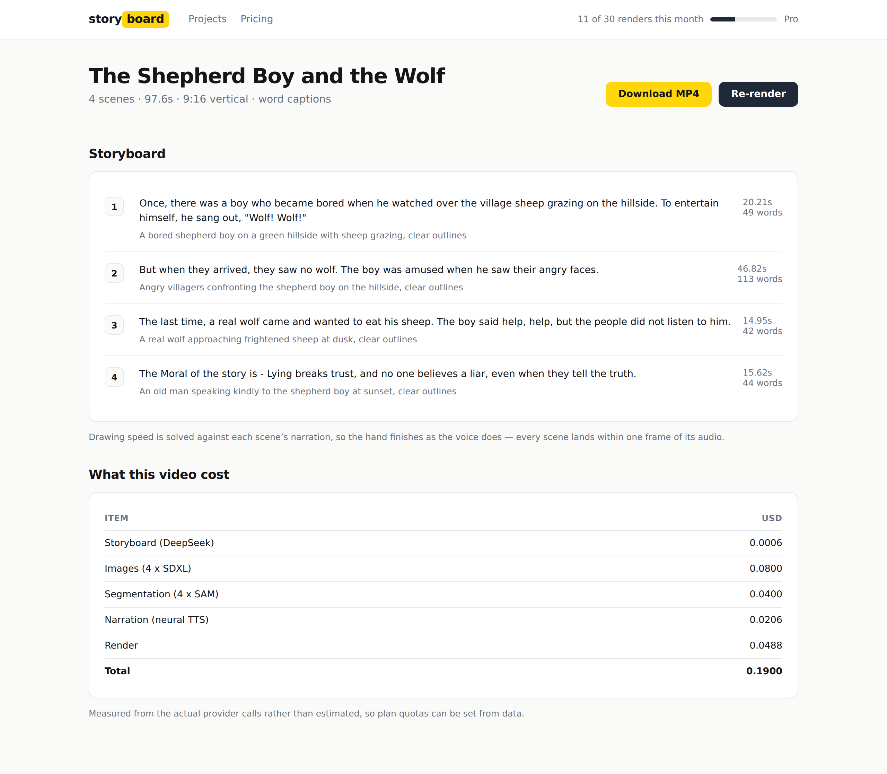
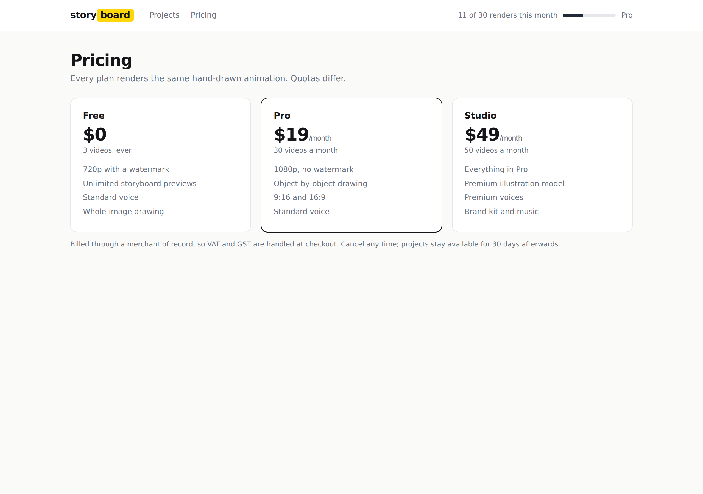

# storyboard-ai (fork): narrated whiteboard videos with Remotion

A fork of Yogendra Yatnalkar's storyboard-ai that ports its whiteboard drawing algorithm to Remotion and builds
narrated, captioned, multi-scene videos from it in one step. A prototype: nothing is deployed.

> **Upstream credit.** This repository is a fork of
> [**storyboard-ai**](https://github.com/yogendra-yatnalkar/storyboard-ai) by
> [**Yogendra Yatnalkar**](https://github.com/yogendra-yatnalkar). The whiteboard drawing algorithm, the Shepherd Boy
> sample (images, masks, narration, transcript) and the original video are his work. This fork branches from upstream
> commit `cdefaf3` (April 2024). Upstream has since been rebuilt as a Gemini-based agentic pipeline; for the current
> version of the original project, go to [his repository](https://github.com/yogendra-yatnalkar/storyboard-ai).

## What and why

Upstream produced one video, *The Story of Shepherd Boy And The Wolf*, with a pipeline in which several steps were
run by hand: images generated elsewhere, masks drawn in AnyLabeling, and FFmpeg commands with per-scene audio padding
typed into `ffmpeg-command-notes.txt`. The core of it is a drawing algorithm that walks the inked tiles of an image in
nearest-neighbour order, one object at a time and the background last, so the result looks hand-drawn.

This fork explores turning that pipeline into a product for solo creators: story text in, narrated whiteboard video
out. It keeps the drawing exactly as upstream draws it and rebuilds everything around it in TypeScript.

## What this fork adds

The changes in this fork were written with Claude Code (an AI coding agent) on the branch
`claude/saas-product-review-1qk9kj` and merged by Avnish Yadav in PR #1 (August 2026).

| Area | What it does | State |
|---|---|---|
| Remotion port (`prototype/remotion-renderer/`) | The drawing algorithm split into a precompute step (tile order and PNG layers per image) and a reveal step (frame number to pixels, no state), so any frame can be rendered or scrubbed on its own | Working |
| Parity harness (`prototype/reference/`, `scripts/compare.ts`) | Compares the port with a Python extraction of the upstream renderer: tile order, sampled frames, and frames rendered in Chromium; exits non-zero on any difference | Working; reported result 0 differing pixels ([prototype/README.md](prototype/README.md)) |
| Video builder (`scripts/buildVideo.ts`) | Builds a multi-scene video in one step: measures each scene's narration, solves the drawing speed so the hand finishes with the voice, adds captions | Working; replaces `ffmpeg-command-notes.txt` |
| Captions (`src/captions/`) | Whisper transcript split per scene by text alignment, provider word timings, or a proportional fallback; word highlighting (vertical) or phrase blocks (landscape); both wrap | Working |
| Output formats | 9:16, 16:9 and 1:1; square art is padded, not stretched; watermark and brand kit (logo, accent colour, caption font, paper colour) | Working; music plays at a fixed level, no ducking |
| Generation CLI (`packages/pipeline/`) | Story, images, narration and masks behind provider interfaces; fixture providers run it offline; prints an estimated cost per video | Runs offline; live providers never called with a real key |
| Billing logic (`packages/pipeline/src/billing/`) | Plans, quota gate, signed and idempotent webhook handling | Logic and tests only; no payment provider, not called by anything |
| Web UI (`apps/web/`) | Next.js pages: projects, new video, project detail, pricing | UI on demo data; not connected to anything (see Known gaps) |
| Database schema (`supabase/migrations/`) | Accounts, projects, render jobs, webhook events, with row-level security | Never applied |
| Fixes to upstream scripts | `VideoWriter` given width for height, `getTextSize` on `None` between subtitles, TTS files written 0-indexed | Done |

[`docs/status.md`](docs/status.md) has the full phase-by-phase account of what is built, stubbed and not started.

## Architecture



- `packages/pipeline/`: generation CLI (`src/generate.ts`), orchestration (`src/pipeline.ts`), providers
  (`src/providers/`), cost estimate (`src/cost.ts`), billing logic (`src/billing/`).
- `prototype/remotion-renderer/`: precompute (`scripts/precompute.ts`, `src/drawing/preprocess.ts`,
  `src/drawing/tilePath.ts`), timing (`src/drawing/timing.ts`), reveal (`src/drawing/reveal.ts`), compositions
  (`src/Root.tsx`, `src/Video.tsx`), captions, watermark, parity and benchmark scripts.
- `prototype/reference/`: the Python ground truth for the parity check.
- `apps/web/`, `supabase/`: UI and schema, not yet connected.
- Everything runs locally: Node for the CLI and build scripts, a headless Chromium driven by Remotion for rendering,
  Python for the reference renderer. [`docs/architecture.md`](docs/architecture.md) covers the design and the
  production setup it plans (not built).

## Quick start

Requirements: Node 22 or later, and for the optional parity check Python 3.11 or later. Remotion downloads a headless
Chromium on first use, or you can point `REMOTION_BROWSER_EXECUTABLE` at a `chrome-headless-shell`.

### 1. Generate a project offline (no API keys)

```bash
cd packages/pipeline
npm ci
npx tsx src/generate.ts --input "The boy who cried wolf" --out ../../prototype/out/generated
```

Prints the scenes, an estimated cost breakdown and the path of `fixture.json`. With the default fixture providers the
story is always upstream's Shepherd Boy sample, whatever `--input` says.

### 2. Build and render the sample video

```bash
cd prototype/remotion-renderer
npm ci
npx tsx scripts/buildVideo.ts --fixture ../fixtures/shepherd-boy.json --name story-portrait --aspect portrait
npx remotion render Story-Portrait ../out/story-portrait.mp4
```

Use `--name story-landscape --aspect landscape` with `Story-Landscape`, or `--name story --aspect square` with `Story`.
To render the project generated in step 1:

```bash
npx tsx scripts/buildVideo.ts --fixture ../out/generated/fixture.json --name generated --aspect portrait
npx remotion render Story ../out/generated.mp4 --props '{"video":"generated"}'
```

Scrub any composition with `npx remotion studio`.

### 3. Run the tests

```bash
(cd prototype/remotion-renderer && npm test)   # 27 tests
(cd packages/pipeline && npm test)             # 41 tests
```

### 4. Check parity with the Python reference (optional)

Install the Python dependencies (`pip install -r requirements.txt`, ideally in a virtualenv), then follow the five
steps in [`prototype/README.md`](prototype/README.md#running-it). `.github/workflows/render-prototype.yml` runs the same
steps on manual dispatch.

### Web UI (prototype)

```bash
cd apps/web
npm install
npm run dev   # http://localhost:3100
```

This needs `apps/web/lib/demoData.ts`, which is not in the repository yet (see Known gaps).

## Environment variables

Names only. None are needed for the quick start.

| Variable | Used for |
|---|---|
| `PROVIDERS` | `fixture` (default) or `live` |
| `DEEPSEEK_API_KEY` | Storyboard generation, when `PROVIDERS=live` |
| `IMAGE_API_KEY` | Illustration generation, when `PROVIDERS=live` |
| `TTS_API_KEY` | Narration, when `PROVIDERS=live` |
| `SEGMENTATION_API_KEY` | Object masks; optional, masking is skipped without it |
| `REMOTION_BROWSER_EXECUTABLE` | Path to a headless Chromium, if Remotion should not download one |

The live providers have never been run with real keys; the TTS and segmentation adapters still point at placeholder
endpoints. Supabase, storage and payment credentials are not wired to anything.

## Demo

<!-- demo video: TBD -->

Rendered frames and UI screenshots, captured from the running code:

| | |
|---|---|
|  |  |
|  |  |

All nine screenshots are listed in [`docs/screenshots/README.md`](docs/screenshots/README.md). The artwork in the
renders is upstream's Shepherd Boy sample.

## Docs

| Doc | What it covers |
|---|---|
| [`docs/status.md`](docs/status.md) | What is built, stubbed and not started |
| [`docs/product-plan.md`](docs/product-plan.md) | Product definition, decisions, phases |
| [`docs/architecture.md`](docs/architecture.md) | Precompute/reveal design and parity constraints |
| [`docs/cost-model.md`](docs/cost-model.md) | Estimated cost per video and pricing analysis |
| [`docs/development.md`](docs/development.md) | Setup and common tasks |
| [`docs/testing.md`](docs/testing.md) | Unit tests, parity harness, end-to-end run |
| [`prototype/README.md`](prototype/README.md) | The Remotion port and how to reproduce the parity result |

## Known gaps

- `apps/web/lib/demoData.ts` is imported by the UI but ignored by the `lib/` rule in `.gitignore`, so the UI does not
  build from a clean clone.
- The UI, billing logic, database schema, generation pipeline and renderer are not connected to each other. No
  deployment, no auth, no checkout.
- Cost figures are estimates from list prices in `packages/pipeline/src/providers/media.ts`, not measured spend.
- The parity workflow runs on manual dispatch only; it is not triggered on push.
- `npm test` uses a test-file glob that needs Node 21 or later.

## The original pipeline (upstream)

The rest of this section is upstream's README, kept for reference. It describes Yogendra Yatnalkar's original work.

https://www.youtube.com/watch?v=iSb1HJXRO04  
[](https://www.youtube.com/watch?v=iSb1HJXRO04)

### How the video was made (upstream)

- The story was taken from the internet.
- A 4-line summary of the story was generated using ChatGPT.
- For each summary line, a corresponding image was generated using Stable Diffusion.
- In each image (4 in this case), the important objects were masked using Meta AI SAM.
- A custom image to whiteboard animation script converted the images to videos (the most time-consuming part of the
  development).
- The audio was generated using gTTS (Google Text-to-Speech).
- The subtitles were generated with the help of OpenAI Whisper.
- The audio, videos and subtitles were synchronized using FFmpeg and OpenCV.

### Code structure (upstream)

- **text-processing**
    - **story.txt**: the story, taken from the internet
    - **summary.txt**: the 4-line summary generated with ChatGPT
- **generate-whiteboard-animated-videos**
    - Converts any image to a whiteboard animation video
    - If object masks are provided as JSON, they are used while drawing
    - **Code file:** `draw-whiteboard-animations.py`
- **tts** (text to speech)
    - The story is divided into 4 parts matching the summary; gTTS generates one mp3 per part.
- **adding-subtitles**: Whisper transcript and the OpenCV subtitle script
- **ffmpeg-command-notes.txt**, **concatinating-video**: the manual FFmpeg steps

### SAM-assisted mask generation (upstream)

- The whiteboard animation is refined by drawing one object at a time.
- The object masks are created with the Meta AI SAM-assisted tagging tool
  [AnyLabeling](https://github.com/vietanhdev/anylabeling).
- After tagging, the tool returns a JSON file that the drawing script uses.
- Videos can also be generated without the JSON masks.

## License

No license file yet in this fork. The upstream project,
[yogendra-yatnalkar/storyboard-ai](https://github.com/yogendra-yatnalkar/storyboard-ai), is licensed under the GNU
General Public License v3.0; its `LICENSE` file was added on 2026-03-23, after this fork's base commit.

## Author

Fork maintained by Avnish Yadav, https://avnishyadav.com. Original project by
[Yogendra Yatnalkar](https://github.com/yogendra-yatnalkar).
