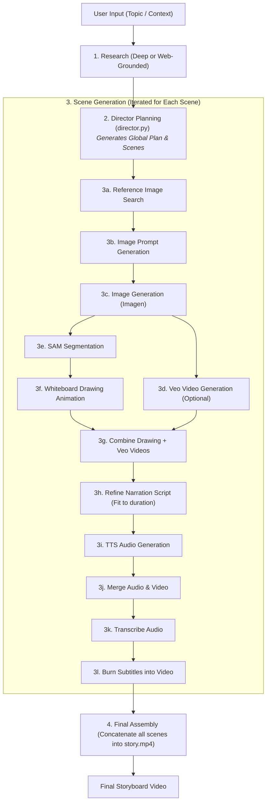

# Storyboard AI - GenAI Pipeline

This directory contains the core generation pipeline that automates the process of converting a topic or instruction set into a fully animated, narrated, and subtitled storyboard video.

## Who Generates the Story?

The story (narrative structure, pacing, script narration, scene breakdown, and visual prompts) is generated by the **Director** module.
* Located in: [director_tool_fn](file:///d:/software-dev/storyboard-ai/genai-pipeline/tools/director.py#L7) inside `tools/director.py`
* The Director receives the user's instructions and optional research reports, plans the global metadata (tone, audience, pacing, narrative persona), and breaks down the project into individual scenes.

---

## High-Level Pipeline Architecture



## Running the Pipeline

You can run the pipeline using `pipeline.py`:
```powershell
python pipeline.py
```
And follow the interactive prompts to choose the research mode, fast mode, narration language, and whether Google Veo video generation is enabled.
